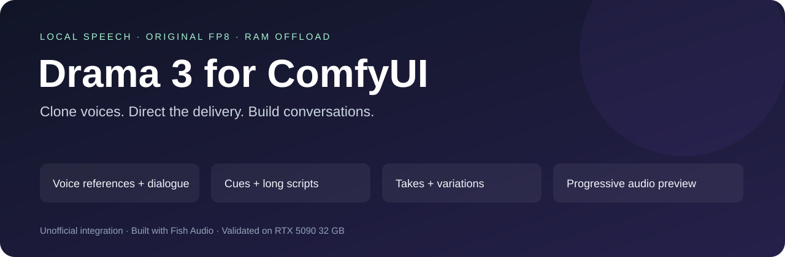

# Drama 3 for ComfyUI



Run [Fish Audio Drama 3](https://huggingface.co/fishaudio/drama-3) locally in ComfyUI with **the original FP8 weights**. Selected routed experts are staged from system RAM so the released checkpoint can run on a **32 GB RTX 5090**. No INT8 conversion, retraining, or speech API is involved.

**Unofficial integration. Built with Fish Audio.** Experimental Windows implementation, validated with ComfyUI 0.39.0 and frontend 1.55.17.

## Listen to the examples

**[▶ Open the audio gallery — play directly in your browser](https://nebuluss.github.io/Drama-3/)**

| Example | Listen |
|---|---|
| French voice cloning | [▶ Français](https://nebuluss.github.io/Drama-3/#fr) |
| Spanish from a French reference | [▶ Español](https://nebuluss.github.io/Drama-3/#es) |
| Italian from a French reference | [▶ Italiano](https://nebuluss.github.io/Drama-3/#it) |
| Two recorded reference voices | [▶ French dialogue: Quenard / Tranié references](https://nebuluss.github.io/Drama-3/#duo) |
| Delivery cues | [▶ Warm](https://nebuluss.github.io/Drama-3/#warm) · [▶ Angry](https://nebuluss.github.io/Drama-3/#angry) · [▶ Sad](https://nebuluss.github.io/Drama-3/#sad) · [▶ Whisper](https://nebuluss.github.io/Drama-3/#whisper) |

All examples are **AI-generated speech**. The gallery has audio players and WAV downloads. [Texts, settings and measurements](examples/README.md).

## What you can do

| Capability | How |
|---|---|
| Text to speech and multilingual scripts | Write the text in the desired language |
| Voice cloning | Connect reference audio and its exact transcript |
| Multiple voice references | Voice Reference → Voice Bank → Speech; speaker IDs 0–15 |
| Dialogue | Use `<\|speaker:0\|>`, `<\|speaker:1\|>`, etc. |
| Emotion and delivery | Natural-language `[cues]`, `direction`, `<whisper>` and `<emphasis>` |
| Long scripts | Sentence-aware automatic chunking, or one part per line |
| Early-stop workaround at commas | `chunk_mode=clauses` queues each clause separately |
| Variations | Generate several seeds while loading the model once |
| Continue or redirect a take | Feed the `take` output into `previous_take` |
| Reuse a voice bank | Save/load compact `.npz` takes containing encoded references |
| Listen during generation | Enable `streaming`, then click **Enable live listening** |
| Replace an audio section | Included manual trim → regenerate → concatenate workflow |

The local public code supports previous audio as conversation context. **Precise word-only inpainting is not implemented here**; redirection generates a new take, and section replacement is a manual edit. See the [official announcement](https://fish.audio/blog/fish-audio-drama-3/) for the separate editing product.

## Installation — Windows / NVIDIA

Requirements: Git, [uv](https://docs.astral.sh/uv/getting-started/installation/), a recent NVIDIA driver, and a current ComfyUI with the dynamic-input API. Hardware validation used a 32 GB RTX 5090 and 128 GB system RAM. Plan for substantial system RAM and at least 60 GB of free storage for the checkpoint, runtime and caches; 64 GB RAM is a reasonable starting point, but only the 128 GB machine has been tested.

From your ComfyUI folder:

```powershell
git clone https://github.com/Nebuluss/Drama-3.git custom_nodes/ComfyUI-Drama3-FP8
cd custom_nodes/ComfyUI-Drama3-FP8
powershell -ExecutionPolicy Bypass -File install.ps1 -RuntimeDir "D:\Models\Drama3Runtime" -CheckpointDir "D:\Models\drama-3"
```

The installer creates an **isolated Python 3.12 runtime**, installs PyTorch 2.8 / CUDA 12.9 and Triton Windows, fetches a pinned Fish Speech revision, applies the small streaming patch, and downloads the pinned checkpoint directly to the chosen drive. It does not install packages into ComfyUI's Python. Caches and the managed Python download also stay in the selected directories.

Already have this exact checkpoint, including `revision.txt`? Add `-SkipDownload`. Another drive is fine; pass explicit directories. The installer stores the runtime location in the local, ignored `runtime.json`. You can also set `DRAMA3_RUNTIME`, or override `runtime_folder` in the Speech node.

Copy `examples/Drama3_demo_*` into `ComfyUI/input`, then restart ComfyUI. Open **Templates → ComfyUI-Drama3-FP8**, or drag one of the [workflow JSON files](workflows) onto the canvas. The example source clips are synthetic.

## Workflows

| Workflow | Purpose |
|---|---|
| [Basic speech](workflows/Drama3-FP8-Workflow.json) | Quick start |
| [Voice cloning](workflows/Drama3-Voice-Cloning-Workflow.json) | One reference and exact transcript |
| [Multiple voices](workflows/Drama3-Multi-Voice-Dialogue.json) | Two references and a speaker-tagged conversation |
| [French cloning](workflows/Drama3-French-Cloning.json) | French speech from a reference voice |
| [Spanish cloning](workflows/Drama3-Spanish-Cloning.json) | Spanish speech from a reference voice |
| [Italian cloning](workflows/Drama3-Italian-Cloning.json) | Italian speech from a reference voice |
| [Expressive / multilingual](workflows/Drama3-Expressive-Multilingual.json) | Delivery cues and paired tags |
| [Long text](workflows/Drama3-Long-Text.json) | Automatic or line-based chunks |
| [Comma-safe clauses](workflows/Drama3-Comma-Safe.json) | Keep later clauses queued after an early stop |
| [Variations](workflows/Drama3-Variations.json) | Three seeds in one job |
| [Continuation](workflows/Drama3-Continuation.json) | Use the previous generated take as context |
| [Redirection](workflows/Drama3-Redirection.json) | Regenerate with a different delivery instruction |
| [Continue existing audio](workflows/Drama3-Continue-Existing-Audio.json) | Encode an existing recording as previous context |
| [Load a saved take](workflows/Drama3-Load-Saved-Take.json) | Reuse encoded references and conversation history |
| [Progressive preview](workflows/Drama3-Progressive-Preview.json) | Play decoded blocks before generation finishes |
| [Replace a section](workflows/Drama3-Replace-Audio-Section.json) | Manual timeline replacement |

Every workflow contains a short usage note. The two default reference clips are related synthetic voices, so they demonstrate routing and conditioning rather than a strong contrast between speakers. Replace them with two distinct voice samples for your own dialogue.

## Voice references and delivery

```text
<|speaker:0|> [warm, cheerful] Hello, welcome back.
<|speaker:1|> [angry] You are late again!
<|speaker:0|> [sad, disappointed] I am sorry about that.
<|speaker:1|> <whisper>It is fine. Come inside.</whisper>
```

For each Voice Reference, provide the clip's **actual words** and its speaker ID. Connect the references to Voice Bank; its inputs grow as you add voices. Multiple clips may share a speaker ID. The model's 0–15 speaker tags are distinct from the number of reference clips.

`direction` applies a delivery cue to each generated part. Cues guide the model; they do not guarantee a particular emotion, accent, speaker identity, or word-perfect reading.

## Settings that matter

- **max_frames** limits each part, not the whole script. `0` selects 600 frames per part for a multi-part script, or 2048 for one part. 256 frames is about 12 seconds. A `length` finish reason means the cap was reached; raise it if speech is truncated.
- **chunk_mode**: `auto` uses the upstream sentence-aware splitter; `single` keeps the whole prompt; `lines` also breaks at newlines; `clauses` also separates commas and punctuation while protecting cues, paired tags and decimals. Separate clauses can introduce more audible pauses and seams. This workaround cannot prevent omissions within a clause.
- **history_turns** retains recent parts in addition to the first. Old history is pruned to fit the upstream prompt limit. `use_history=False` reuses a saved take's reference bank while starting fresh.
- **variations** increments the seed and returns separate audio/take outputs. Save Audio writes each variation separately. More variations take proportionally more generation time.
- **streaming** decodes blocks of 64 frames, about 3 seconds of speech. Loading and prefill still happen first. It is progressive playback, **not guaranteed real-time playback**: you may wait between blocks. Decoder windows retain 128 frames of context to bound memory; long streams can differ slightly from decoding the entire utterance at once.
- **release_comfy_models** frees ComfyUI's loaded models before speech by default. Each job exits its isolated process afterward, returning the VRAM to ComfyUI. The speech model reloads for the next job.

Avoid simultaneous speech jobs or other GPU-heavy applications. The node chooses its weight budget from free VRAM, but another process allocating memory afterward can still cause an out-of-memory error. Cancel in ComfyUI to stop the isolated child process.

Save Take writes to `ComfyUI/output`; copy the `.npz` file into `ComfyUI/input` before selecting it in Load Take. Takes contain transcripts, integer VQ codes and encoded references, not model weights. Loading uses NumPy with pickle disabled.

## Examples and validation

[Listen to the generated examples and read their settings](examples/README.md). These are local synthetic-voice demonstrations, not a voice-cloning quality benchmark.

Actual ComfyUI API validation covered two references, speaker IDs, four delivery instructions, two variation seeds, multi-part context, progressive WebSocket events, saving/loading takes, reference override, and French/Spanish/Italian clause-by-clause generation. The dialogue and multilingual parts ended naturally with EOS. A separate longer streaming test reached its 256-frame cap; it verified preview blocks at 64, 128, 192 and 256 frames and is recorded as a capped stress test. The original FP8 expert staging also passed a bit-for-bit comparison against resident FP8 experts on the 5090.

Detailed measurements and the longer streaming test are included with the examples. Timings are specific to this machine and these scripts; loading, prompt length, reference length, RAM bandwidth and other GPU use affect results. The installer was syntax-checked, argument forwarding was checked, and its patch was verified against the pinned upstream source. A second complete installation/download has not been run.

## Credits and license

- [Fish Audio Drama 3 weights](https://huggingface.co/fishaudio/drama-3), revision `dd64a85cd82e9521f7202610ede97b367fc83946`.
- [Fish Speech source](https://github.com/fishaudio/fish-speech), commit `1ff3c3ed2f80d3106a83909dd25b83129c3d816f`.
- [ComfyUI](https://github.com/comfyanonymous/ComfyUI).

See [LICENSE](LICENSE) and [NOTICE](NOTICE) for the Fish Audio Community License and attribution. Model weights are downloaded from Fish Audio and are not included here. Use references you have the right to use; the upstream license includes consent and misuse restrictions.
